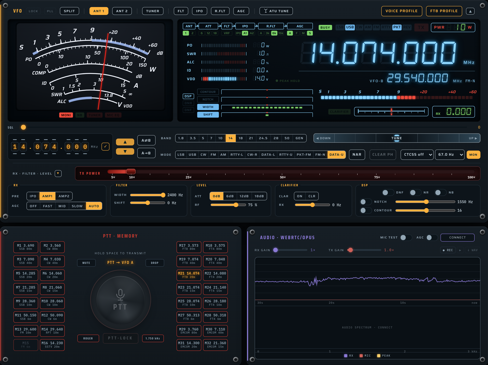
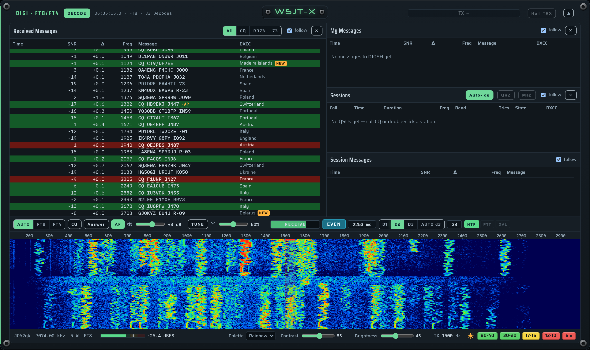

# FT-950 Remote

Web remote control for a **Yaesu FT-950** on a Raspberry Pi, talking to the
radio directly through a **Yaesu SCU-17** (CAT + USB audio). It does not use
hamlib and runs CAT at **38400 Bd**. The focus is **FT8/FT4** with strong
decoding, plus voice operation over WebRTC.





## Features

- **VFO panel** with an LCD modelled on the FT-950's own display:
  - FT-2000 style analog meter (S, PO, COMP, ID, SWR, ALC/VDD) in its own window
  - signal path (ANT · ATT · FLT · IPO · R.FLT · AGC) as fixed cells, only the
    active values lit; DSP bars; mode lamps (LSB USB CW AM FM RTTY PKT REV)
  - seven-segment frequency, tunable by mouse wheel or drag on a digit;
    clarifier scale, VFO-B
  - PO / SWR / ALC / ID (amps) / AF bars while transmitting
  - title bar: split, ANT 1/2, tuner and ATU tuning, CLAR/CLR, FLT · IPO ·
    R.FLT · AGC switches, **voice profile** and **FT8 profile** (both diff-apply
    and verify every value by reading it back)
  - band and mode keys, a frequency **shuttle** (hold left/right — the further
    out, the bigger the steps), CTCSS (ENC/TSQ, 50 tones), MON, NAR
  - a dominant scaled TX power control
  - RX · filter · level group: width/shift, AGC, roofing, preamp, ATT, RF gain
- **PTT · Memory**:
  - push-to-talk from the browser with a watchdog lease, PTT-LOCK, roger beep,
    1750 Hz tone call; MUTE and DROP (blank the current over) with chimes
  - 32 memory keys: click recalls (with CTCSS, VFO B and split), hold 3 s stores VFO A; editable with names, default plan for 80–6 m
    under Settings ▸ Memories (written with `MW` and verified)
- **Audio** over WebRTC/Opus in both directions:
  - RX/TX gain, mic AGC, switchable compressor and pre-emphasis, level graph
  - mic echo test, an RX recorder with playback and WAV download
  - the microphone stays muted unless you transmit; speech since the key press
    is kept (pre-roll)
- **DIGI (FT8/FT4)**:
  - decoding with WSJT-X's own decoder `jt9` (adaptive depth, early and
    partner passes, the passband split over three CPU cores)
  - received / my messages / sessions tables with DXCC and worked-before flags
  - waterfall with TX/RX markers, DIGI RX level on the Pi
  - a WSJT-X style QSO sequencer (CQ, answer, reports, RR73/73) with
    auto-answer; FT8/FT4 waveform generation for transmit
  - **HF band conditions** under the waterfall, as iDigi shows them:
    80-40 · 30-20 · 17-15 · 12-10 · 6m in green / yellow / red, computed by
    real **VOACAP** for your own locator; the sun/moon shows day or night at
    the station and switches the view to the other half of the day
- **CW skimmer**: every CW signal in the passband decoded at once (own STFT
  front end, adaptive timing), listed like the FT8 table; select one, zero
  beat, send through the radio's own keyer (`KM`/`KY`) with macros
- **HackRF waterfall**: panadapter or wideband sweep from a HackRF One on
  another Pi, relayed from TM-V71 Remote's `/ws/hackrf`; follow shows the
  whole amateur band of VFO A; click tunes VFO A
- **Radio power** via a Shelly relay (Gen1 and Gen2+): title-bar switch,
  power-off plate, auto power-off when no browser is connected
- **Log**:
  - Wavelog upload (auto-log or log form)
  - QRZ.com XML lookup and logbook upload
  - worked-before index downloaded from Wavelog
- **Settings**:
  - station data, serial port and baud rate, decoder range, HackRF source,
    Shelly
  - the FT-950's audio menus with saved defaults, FT8 TX drive, voice TX
    processing
  - WebRTC buffers, logbook accounts, memories (with FT8/FT4 defaults)
  - Pi hardware graphs

## Hardware

- Raspberry Pi with Debian 13 / Raspberry Pi OS. **A Raspberry Pi 5 is
  strongly recommended:** FT8/FT4 are decoded by WSJT-X's `jt9`, and on a
  busy band that is the heaviest job on the Pi. The Pi 5's much faster
  cores (the test suite runs about 2.3× faster than on a Pi 4) mean decodes
  on screen sooner and more decoding depth in the same time. A Pi 4 works,
  but on a full band the adaptive depth then often has to drop to depth 1.
- Yaesu SCU-17, which contains:
  - CP2105 dual UART: the "Enhanced" port is CAT (38400 Bd, 8N1, `;`
    terminator) and the "Standard" port is PTT/CW over RTS/DTR
  - TI PCM2903B USB audio codec for RX and TX

Radio menu settings:
- **026 = 3** (38400 Bd)
- **027 = 0** (10 ms CAT timeout)
- **031**: TX timeout, as a safety net
- for FT8 also see `docs/FT8-DECODING.md` (data levels 050/051, 054/055)

## Install

```bash
sudo apt install wsjtx voacapl    # WSJT-X: jt9 (FT8/FT4 decoder), ft8code/ft4code (TX tones)
                                  # voacapl: VOACAP for the band conditions under the waterfall
cd backend && python3 -m venv .venv && .venv/bin/pip install -r requirements.txt
.venv/bin/uvicorn app.main:app --host 0.0.0.0 --port 8444   # development
```

For production use the systemd unit in `deploy/systemd/`. It serves HTTPS
on port 8444; the certificate comes from `deploy/gen-server-cert.sh`, signed
by a private root CA, which the UI offers for download. Browsers allow the
microphone only over HTTPS.

The station settings, logbook credentials and memory names are entered in the
web UI. They are saved to `backend/runtime.json` (mode 0600, gitignored) and
never sent back to the browser.

## Band conditions (VOACAP)

The strip at the bottom right of the DIGI panel is computed on the Pi with
VOACAP (`voacapl`, Debian package), the same engine and deck format as
[voacap-matrix](https://github.com/CQ-DJ0SH/voacap-matrix). VOACAP predicts a
path, not a place, so "how open is 20 m here" is asked of a ring of 36 paths
around your locator (12 directions × 1500 / 4000 / 9000 km) at 100 W FT8 with
an isotropic antenna. Per band the reliability is the mean over the ring; a
pair is as good as its better band: green from 0.6, yellow from 0.3, red
below.

- **When it updates:** one run covers all 24 UTC hours of the month's median
  ionosphere (about 0.5 s, at low priority so `jt9` never waits). It is
  computed once per UTC day and again when the locator or the sunspot number
  changes. The sunspot number is NOAA SWPC's latest monthly value, fetched
  once a day; the last good one is kept for an offline Pi. The page asks
  every 5 minutes, so the strip moves to the next hour, and the sun/moon to
  sunrise or sunset, within 5 minutes.
- **Sun / moon:** follows the real time of day at your locator. A click shows
  the other half of the day — the mean over today's daylight or darkness
  hours there — framed and with dashed chips, so it is never taken for the
  present; a second click goes back to now.
- **Limits:** VOACAP is a monthly median of the F2 layer. It does not see
  flares or geomagnetic storms, and on **6 m** it shows only the rare F2
  openings of a solar maximum, not the sporadic-E that opens 6 m in a
  European summer — a red 6m chip does not rule out Es.
- Without `voacapl`, or without a locator in Settings ▸ General, the strip is
  simply not shown. Its working tree `backend/itshfbc/` and the cached
  sunspot number `backend/propagation.json` are gitignored.

## Documents

| File | Content |
|---|---|
| `docs/VFO-PANEL-DESIGN.md` | VFO panel design, every control mapped to its CAT command |
| `docs/CAT-REFERENCE.md` | all 97 CAT commands, the `SH` width table, relevant menus, pitfalls |
| `docs/FT8-DECODING.md` | audio path, `jt9` decoder, time base, FT8 radio profile, transmit, sequencer |

Yaesu's *FT-950 CAT Operation Reference Book* is the primary source. It is
copyrighted and therefore not in this repository; download it from yaesu.com
and place it at `docs/FT-950_CAT_Manual_ENG.pdf`.

## Notes

- The manufacturer logo and the Neuropol nameplate font are not included
  (trademark / unclear licence). The UI falls back to Saira Condensed, and
  a logo can be uploaded under Settings.
- PO/SWR conversion uses approximate calibration points and has not been
  checked against a reference meter.

## Licence

GNU GPL v3. The bundled fonts (Saira, Saira Condensed, IBM Plex Mono, DSEG7)
are under the SIL Open Font License; see `frontend/fonts/licenses/`.

Author: DJ0SH
